<!-- ░▒▓ HEADER ▓▒░ -->
<p align="center">
  
</p>

<p align="center">
  <a href="https://github.com/Jishnuraj07">
    
  </a>
</p>

<p align="center">
  
  <a href="https://github.com/Jishnuraj07?tab=followers"></a>
  
</p>

---

### 💻 whoami

```ts
const jishnu = {
  role: "GenAI Developer",
  company: "Accenture",
  location: "Pune, India",
  languages: ["Python", "TypeScript"],
  stack: ["FastAPI", "Next.js", "Node", "Electron"],
  ai: ["Claude API", "NVIDIA NIM", "RAG", "Docling"],
  into: ["coding agents", "local-first apps"],
  brain: "ADHD, 14 tabs open",
  now: "making coding agents fun to use",
};
```

---

### ⚡ Featured builds

| | Project | What it does |
|---|---|---|
| 🎭 | **[larper](https://github.com/Jishnuraj07/larper)** | A real coding agent in five switchable costumes: netrunners, Greek gods, a fantasy party, a starship bridge, or a LinkedIn parody |
| 🌃 | **[ambrosia](https://github.com/Jishnuraj07/ambrosia)** | Cyberpunk heist coding agent. Failing tests spawn hostile programs, fixes earn street cred |
| 🗂️ | **[indicis](https://github.com/Jishnuraj07/indicis)** | Your notes as a slip box: local-first knowledge graph with live physics, Docling import and Claude suggestions |
| 🎧 | **[daedalus](https://github.com/Jishnuraj07/daedalus)** | Hands-free Claude Code. Speaks up when it needs you, knows when you're looking. Zero deps, three platforms |
| 🧠 | **[EdgeAI NIM RAG](https://github.com/Jishnuraj07/EdgeAI-NVIDIA-NIM-based-RAG-chatbot)** | Fully local RAG on NVIDIA NIM: LLM, embeddings and reranker on GPU |

---

### 🛠️ Loadout

<p align="center">
  
</p>

<p align="center">
  
  
  
  
  
</p>

---

### 📡 Telemetry

<p align="center">
  
  
</p>

<p align="center">
  
</p>

<p align="center">
  
</p>

<p align="center">
  <picture>
    <source media="(prefers-color-scheme: dark)" srcset="https://raw.githubusercontent.com/Jishnuraj07/Jishnuraj07/output/snake-dark.svg"/>
    <source media="(prefers-color-scheme: light)" srcset="https://raw.githubusercontent.com/Jishnuraj07/Jishnuraj07/output/snake.svg"/>
    
  </picture>
</p>

<!-- ░▒▓ FOOTER ▓▒░ -->
<p align="center">
  
</p>
